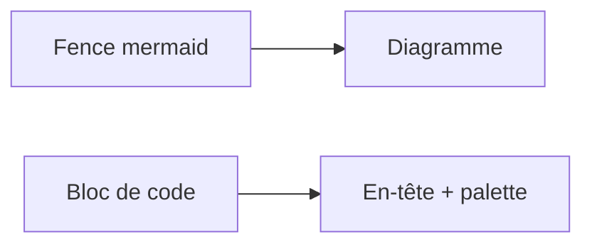

Cette page illustre le render hook `layouts/_markup/render-codeblock.html` : **par défaut, chaque bloc de code fenced Markdown affiche un en-tête** — icône du langage et libellé (nom de fichier > titre > langage) à gauche, bouton « copier le code » à droite. Toutes les options se passent dans l'info string du bloc, sans shortcode ; les options Chroma (`lineNos`, `hl_lines`…) passent telles quelles au coloriseur.

## Par défaut : un en-tête sur chaque bloc

Sans rien écrire, un bloc affiche déjà l'icône de son langage, son nom de langage et le bouton copier :

```html
<p>Hello World</p>
```

## Nom de fichier

L'attribut `filename="..."` affiche le nom du fichier dans l'en-tête — le rendu « écran » :

```python {filename="hello.py"}
print("Hello World")
```

## Titre libre

L'attribut `title="..."` affiche un libellé libre (« Installation », « Extrait »…). Si `filename` est présent, il gagne :

```bash {title="Installation"}
echo "Hello World"
```

## Icône explicite (Simple Icons)

L'attribut `icon="..."` force une icône donnée (slug Simple Icons) — utile pour un langage non mappé ou pour le texte brut :

```text {icon="hugo"}
content/
layouts/
```

## Langage non mappé

Un langage absent du mapping (`zig` ici) n'affiche pas d'icône — l'en-tête reste complet :

```zig
const std = @import("std");
```

## Opt-out par bloc

`{icon=false}` / `{copy=false}` désactivent une option pour un bloc, même si elle est active par défaut :

```js {copy=false}
console.log('pas de bouton copier');
```

## Rendu natif Hugo (tout désactivé)

Un bloc sans nom de fichier ni titre, avec `{icon=false copy=false}`, passe par `transform.HighlightCodeBlock` : rendu strictement identique à celui de Hugo, aucune régression :

```html {icon=false copy=false}
<p>Hello World</p>
```

## Options Chroma (pass-through)

Toutes les options du shortcode `highlight` fonctionnent dans l'info string — `lineNos`, `hl_lines`, `lineNoStart`, `anchorLineNos`… :

```go {lineNos=true, hl_lines=[2,3], lineNoStart=10}
func main() {
    fmt.Println("Hello")
    fmt.Println("World")
}
```

Les couleurs viennent de palettes générées au build (`layouts/_partials/highlight.html`) : `github` en mode clair, `github-dark` en mode sombre (l'OS pilote le choix) — et l'en-tête partage la palette du code. Paire libre via `params.code.styles.light/.dark`. NB : un `{style="..."}` par bloc est sans effet en mode classes — la palette est globale.

## Diagrammes Mermaid

Une fence `mermaid` rend un diagramme, pas un bloc de code (hook dédié `render-codeblock-mermaid.html`, prioritaire sur le hook générique) ; le shortcode `` continue de fonctionner à l'identique :



## Récapitulatif

| Syntaxe | Effet |
| --- | --- |
| — | En-tête complet (icône + langage + copier), par défaut |
| `{filename="hello.py"}` | Nom de fichier dans l'en-tête (prioritaire sur `title`) |
| `{title="Installation"}` | Libellé libre |
| `{icon="python"}` | Icône explicite (slug Simple Icons) |
| `{icon=false}` | Pas d'icône pour ce bloc |
| `{copy=false}` | Pas de bouton copier pour ce bloc |
| `{icon=false copy=false}` | Rendu natif Hugo (sans libellé) |
| `{lineNos=true}` etc. | Options Chroma passées au coloriseur |

## Notes

- **Défauts globaux** : icône et bouton copier sont **actifs par défaut** ; `params.code.icon: false` / `params.code.copy: false` (`config/_default/params.yaml`) les désactivent pour tout le site — l'info string du bloc gagne toujours.
- **Syntaxe** : un attribut sans valeur (`{icon}`, `{copy}`) est invalide pour le parseur d'attributs Markdown (Goldmark) — écrire `icon=true` / `copy=true`, ou ne rien écrire (c'est le défaut).
- **Langages non reconnus par Chroma** (drupal, flutter, mongodb…) : rendus en texte brut, mais l'icône du mapping s'affiche ; une icône explicite (`{icon="drupal"}`) reste la solution la plus propre.
- **Accessibilité** : vrai `<button>` icône seule, `aria-label` basculé vers « Code copié » pendant 2 s, fallback `execCommand` pour les contextes non sécurisés.
- **Icônes du bouton** : Lucide `copy` / `check`, émises via le partial `icon` du module `hugolify-theme-icons` ; sans ce module, le bouton reste fonctionnel (libellé via `aria-label`).
- **Impression** : le bouton copier est masqué à l'impression.

## Icônes — un exemple par langage du mapping

Un bloc pour chaque langage mappé dans `layouts/_partials/func/GetCodeIcon.html`, dans l'ordre du mapping, alias inclus (`js` et `javascript` partagent la même icône) — l'icône s'affiche sans aucune option, c'est le défaut. Les langages non reconnus par Chroma sont rendus en texte brut — l'icône du mapping s'affiche quand même.

```angular
<button [disabled]="isLoading">Valider</button>
```

```angular2
<button [disabled]="isLoading">Valider</button>
```

```astro
---
layout: ../layouts/Base.astro
---
<h1>Bonjour</h1>
```

```bash
echo "Hello World"
```

```css
.title {
  color: rebeccapurple;
}
```

```dart
void main() { print('Bonjour'); }
```

```docker
FROM alpine:3
RUN apk add curl
```

```dockerfile
FROM node:20-alpine
COPY . .
RUN npm ci
```

```drupal
function demo_form_alter(&$form, $form_state) {
  $form['#validate'][] = 'demo_validate';
}
```

```elixir
def hello, do: IO.puts("Bonjour")
```

```elm
main =
  text "Bonjour"
```

```erlang
hello() ->
  io:format("Bonjour~n").
```

```flutter
const Text('Bonjour')
```

```git
git commit -m "feat: blocs de code"
```

```gitlab
image: node:20
script:
  - npm test
```

```go
fmt.Println("Bonjour")
```

```golang
func main() { fmt.Println("Bonjour") }
```

```gql
query {
  user(id: 1) {
    name
  }
}
```

```graphql
type Query {
  hello: String
}
```

```haskell
main = putStrLn "Bonjour"
```

```htm
<p>Bonjour</p>
```

```html
<p>Bonjour le monde</p>
```

```hugo
{{ range .Pages }}{{ .Title }}{{ end }}
```

```java
System.out.println("Bonjour");
```

```javascript
console.log('Bonjour');
```

```js
const somme = (a, b) => a + b;
```

```jsx
<Bouton label="Bonjour" onClick={valider} />
```

```tsx
<Bouton label="Bonjour" onClick={valider} />
```

```k8s
apiVersion: v1
kind: Pod
```

```kotlin
fun main() = println("Bonjour")
```

```kubernetes
kubectl get pods -n prod
```

```laravel
Route::get('/bonjour', fn () => 'Bonjour');
```

```less
@primaire: rebeccapurple;
.title {
  color: @primaire;
}
```

```lua
print("Bonjour")
```

```markdown
**Bonjour le monde**
```

```md
## Bonjour

Un titre de section.
```

```mongodb
db.utilisateurs.find({ actif: true })
```

```mysql
SELECT * FROM utilisateurs WHERE actif = 1;
```

```next
export default function Page() {
  return <h1>Bonjour</h1>;
}
```

```nextjs
export const metadata = { title: "Bonjour" };
```

```nginx
location / {
  proxy_pass http://app:3000;
}
```

```perl
print "Bonjour\n";
```

```php
<?php echo "Bonjour";
```

```postgres
SELECT count(*) FROM utilisateurs;
```

```postgresql
SELECT NOW();
```

```powershell
Get-ChildItem -Recurse -Filter *.log
```

```ps1
Write-Host "Bonjour"
```

```py
print("Bonjour")
```

```python
print("Bonjour le monde")
```

```r
x <- c(1, 2, 3)
mean(x)
```

```rb
puts "Bonjour"
```

```react
<button onClick={valider}>Valider</button>
```

```redis
SET salut "Bonjour"
```

```rs
println!("Bonjour");
```

```rust
fn main() {
    println!("Bonjour le monde");
}
```

```sass
$primaire: rebeccapurple
```

```scss
.title {
  color: $primaire;
}
```

```sh
ls -la
```

```shell
echo "Bonjour"
```

```solidity
contract Bonjour {
    string public salut = "Bonjour";
}
```

```sqlite
SELECT * FROM utilisateurs LIMIT 5;
```

```svg
<svg xmlns="http://www.w3.org/2000/svg"><circle r="10" /></svg>
```

```svelte
<h1>{titre}</h1>
```

```swift
print("Bonjour")
```

```symfony
#[Route('/bonjour', name: 'bonjour')]
public function bonjour(): Response {}
```

```tailwind
<div class="flex items-center gap-2">Bonjour</div>
```

```tailwindcss
@tailwind utilities;
```

```terraform
resource "aws_instance" "web" {
  ami = "ami-123456"
}
```

```tf
resource "aws_s3_bucket" "cdn" {
  bucket = "cdn"
}
```

```ts
const id: number = 1;
```

```typescript
function direBonjour(nom: string): string {
  return 'Bonjour ' + nom;
}
```

```vite
import { defineConfig } from "vite";

export default defineConfig({});
```

```vue
<template>
  <p>{{ msg }}</p>
</template>
```

```wordpress
add_action("init", "mon_init");
```

```xml
<utilisateur>
  <nom>Thomas</nom>
</utilisateur>
```

```zsh
echo $SHELL
```
